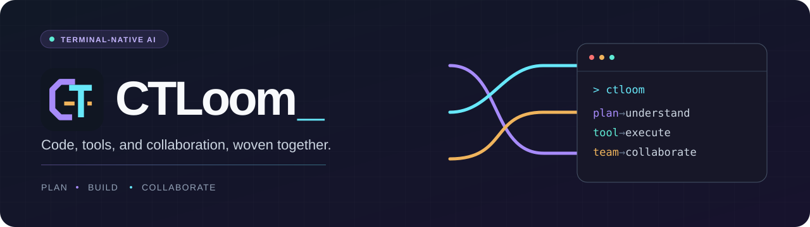
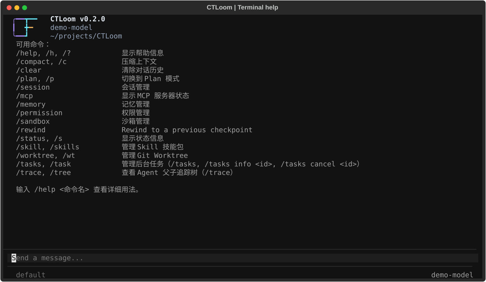
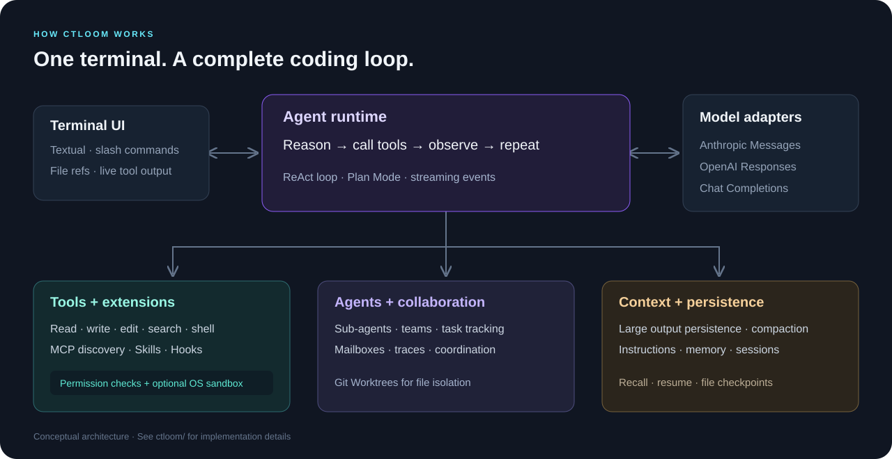

<p align="center">
  
</p>

<h1 align="center">CTLoom</h1>

<p align="center">
  <strong>在终端里理解项目、规划任务、修改代码。</strong><br>
  A terminal-native AI coding assistant with planning, tools, and multi-agent collaboration.
</p>

<p align="center">
  <a href="pyproject.toml"></a>
  <a href="pyproject.toml"></a>
  <a href="ctloom/app.py"></a>
  <a href="LICENSE"></a>
</p>

<p align="center">
  <a href="#quick-start">快速开始</a> ·
  <a href="#preview">界面预览</a> ·
  <a href="#features">核心能力</a> ·
  <a href="#configuration">模型配置</a> ·
  <a href="#commands">常用命令</a> ·
  <a href="#extensions">扩展指南</a> ·
  <a href="#development">参与开发</a>
</p>

CTLoom 是基于 Python 与 Textual 构建的 AI 编程助手。它将模型对话、文件操作、Shell 命令、任务规划和多 Agent 协作放在同一个终端工作流中，并通过 MCP、Skills 与 Hooks 扩展能力。

项目使用原创的 **CT 编织标识**，统一应用于终端、浏览器和文档。SVG、PNG、ICO 图标资源及用法见 [视觉标识](docs/branding.md)。

<a id="preview"></a>
## 界面预览



*真实 Textual 界面，通过本地 `/help` 命令截取；使用演示配置，无需调用模型 API。终端左上角为 CTLoom 专属的 CT 编织标识。*

<a id="features"></a>
## 核心能力

| 能力 | 可以做什么 |
| --- | --- |
| **ReAct 与 Plan Mode** | 在推理、工具调用和结果反馈之间循环；复杂任务先整理方案，再进入实现阶段。 |
| **多模型协议** | 接入 Anthropic、OpenAI Responses 和 OpenAI 兼容的 Chat Completions 接口。 |
| **项目内工具** | 读取、创建和编辑文件，按路径或内容搜索，执行 Shell 命令，并在输入中用 `@文件路径` 引用文件。 |
| **MCP 工具发现** | 连接本地 stdio 或远程 Streamable HTTP 服务，通过 `ToolSearch` 按需发现工具定义。 |
| **多 Agent 与团队协作** | 使用 Explore、Plan、General-purpose 等子 Agent；管理后台任务、团队消息和 Agent 追踪树。 |
| **Git Worktree 隔离** | 为任务创建独立工作目录，查看状态，在主工作区与 Worktree 之间切换。 |
| **上下文与记忆** | 对过长工具结果落盘、压缩对话上下文，保存会话并提取跨会话记忆。 |
| **权限与沙箱** | 结合权限模式、路径检查、命令检测、自定义规则和人工确认；可选用平台支持的 OS 沙箱。 |
| **Skills 与 Hooks** | 用 Markdown 技能包复用工作流，在生命周期事件中注入提示、执行命令或调用 HTTP 服务。 |

<a id="quick-start"></a>
## 快速开始

### 1. 准备环境并安装

需要 **Python 3.11+**、Git，以及可用的模型 API。使用本地 MCP 服务时，还需安装该服务依赖的运行时，例如 Node.js / `npx`。

```bash
git clone https://github.com/Nature-Porter/CTLoom.git
cd CTLoom
```

如果已安装 [uv](https://docs.astral.sh/uv/)，可按仓库锁文件安装：

```bash
uv sync
```

也可以使用 pip：

```bash
python -m venv .venv
```

激活虚拟环境，然后安装项目：

```bash
# macOS / Linux
source .venv/bin/activate
python -m pip install -e .
```

```powershell
# Windows PowerShell
.\.venv\Scripts\Activate.ps1
python -m pip install -e .
```

### 2. 创建本地配置

在**准备使用 CTLoom 的项目目录**中创建配置。以下操作在克隆的仓库内执行：

```bash
# macOS / Linux
mkdir -p .ctloom
cp config.yaml.example .ctloom/config.local.yaml
export ANTHROPIC_API_KEY="你的 API 密钥"
```

```powershell
# Windows PowerShell
New-Item -ItemType Directory -Force .ctloom | Out-Null
Copy-Item config.yaml.example .ctloom/config.local.yaml
$env:ANTHROPIC_API_KEY = "你的 API 密钥"
```

编辑 `.ctloom/config.local.yaml`：将 `model: your-model-id` 替换为服务商实际提供的模型 ID；如使用代理服务，同时修改 `base_url`。保留 `api_key: ""` 时，程序会读取对应的 API 密钥环境变量。

> 配置必须位于 `.ctloom/` 下或用户全局配置目录中；默认启动不会读取仓库根目录的 `config.yaml`。仓库已忽略 `.ctloom/config.local.yaml`，请将个人密钥保存在环境变量或这个本地文件中。

### 3. 启动并开始任务

```bash
# uv 安装方式
uv run ctloom

# pip 安装方式：先激活虚拟环境
ctloom
```

进入终端界面后，可以先输入 `/help`，也可以直接描述任务：

```text
阅读这个项目，说明入口、目录结构和主要模块之间的关系。

@ctloom/config.py 解释配置加载顺序，并指出新增配置项需要修改的位置。

/plan 为项目增加一个配置校验命令，先列出实现步骤和验证方案。
```

Windows 可以使用 PowerShell 启动终端界面。Shell 工具在 Windows 上运行命令时仍需注意命令语法；OS 级沙箱目前仅提供 macOS 和 Linux 后端。

<a id="configuration"></a>
## 模型与配置

### 选择正确的协议

| `protocol` | 接口类型 | 密钥环境变量 |
| --- | --- | --- |
| `anthropic` | Anthropic Messages | `ANTHROPIC_API_KEY` |
| `openai` | OpenAI Responses | `OPENAI_API_KEY` |
| `openai-compat` | OpenAI 兼容 Chat Completions | `OPENAI_API_KEY` |

最小 Anthropic 配置：

```yaml
providers:
  - name: anthropic
    protocol: anthropic
    base_url: https://api.anthropic.com
    api_key: ""
    model: your-model-id

permission_mode: default
```

若服务商提供 Chat Completions 兼容接口，可以改为：

```yaml
providers:
  - name: compatible-provider
    protocol: openai-compat
    base_url: https://your-provider.example/v1
    api_key: ""
    model: your-model-id

permission_mode: default
```

示例域名与模型 ID 均需替换。如果服务支持 Responses API，则使用 `protocol: openai`。配置多个 Provider 时，终端界面会在启动时显示选择列表。

可选字段包括 `thinking`、`context_window` 和 `max_output_tokens`；应按模型服务实际支持的能力填写。完整示例见 [config.yaml.example](config.yaml.example)，解析逻辑见 [config.py](ctloom/config.py)。

### 配置加载顺序

程序依次加载并合并以下文件：

| 顺序 | 路径 | 用途 |
| --- | --- | --- |
| 1 | `~/.ctloom/config.yaml` | 用户全局配置，便于在多个项目中复用 Provider。 |
| 2 | `<项目>/.ctloom/config.yaml` | 项目配置。 |
| 3 | `<项目>/.ctloom/config.local.yaml` | 本地配置，可存放个人 Provider 设置。 |

后层非空 `providers` 会替换前层列表；MCP 服务按名称合并，Hooks 会追加。其他配置项各有合并规则，不能将整个配置理解为简单的逐字段覆盖，详见 [`_merge_config`](ctloom/config.py)。

### 权限模式

```bash
uv run ctloom --mode default
uv run ctloom --mode plan
```

| 模式 | 主要行为 |
| --- | --- |
| `default` | 默认允许读取，文件修改和普通命令通常需要确认。 |
| `acceptEdits` | 默认允许文件修改，普通命令仍通常需要确认。 |
| `plan` | 进入规划工作流；计划文件有专门处理，其他操作仍经过权限检查。 |
| `bypassPermissions` | 默认放行工具调用；危险命令检测和适用的拒绝规则仍会生效。 |

这些是模式的默认行为；路径检查、安全命令判定、显式规则等也会影响最终决定。`plan` 不等于操作系统级只读隔离。交互时可用 `Shift+Tab` 循环切换模式，或用 `/permission mode <模式>` 指定模式。

<a id="commands"></a>
## 常用命令与快捷键

| 命令 | 用途 |
| --- | --- |
| `/help`、`/help <命令名>` | 查看全部命令或某个命令的参数。 |
| `/plan [任务描述]` | 进入规划模式，可同时提交任务。 |
| `/status` | 查看模型、Token 与当前状态。 |
| `/compact [保留重点]` | 压缩当前上下文。 |
| `/clear` | 清除当前对话历史。 |
| `/session list`、`/session resume <id>` | 列出并恢复已保存的会话。 |
| `/session new` | 新建会话。 |
| `/memory list` | 查看记忆。 |
| `/permission`、`/permission rules` | 查看权限模式和规则。 |
| `/sandbox` | 查看或切换 OS 沙箱状态。 |
| `/mcp` | 查看 MCP 服务和工具连接状态。 |
| `/skill list`、`/skill reload` | 查看或重新加载技能。 |
| `/tasks`、`/trace` | 查看后台任务与 Agent 追踪树。 |
| `/worktree list`、`/worktree status` | 查看 Worktree 列表和状态。 |
| `/rewind` | 查看并选择回退检查点。 |

| 按键 / 输入 | 操作 |
| --- | --- |
| `Enter` | 发送消息或执行命令。 |
| `Shift+Enter` / `Ctrl+J` | 输入换行。 |
| `Tab` | 补全命令或文件引用。 |
| `↑` / `↓` | 浏览历史输入或补全候选。 |
| `Shift+Tab` | 切换权限模式。 |
| `Ctrl+O` | 展开 / 折叠工具调用详情。 |
| `Esc` | 取消当前操作或关闭补全。 |
| `Ctrl+C` | 中断或退出，按界面状态处理。 |
| `@路径` | 将文件内容作为上下文引用。 |

### 脚本调用与浏览器入口

```bash
# 单次运行，输出最终文本
uv run ctloom -p "说明这个项目的主要模块"

# 以 NDJSON 逐行输出流式事件
uv run ctloom -p "分析项目结构" --output-format stream-json

# 启动浏览器界面，然后访问 http://localhost:18888
uv run ctloom --remote

# 查看 CLI 参数
uv run ctloom --help
```

`-p` 使用首个 Provider，当前实现会自动批准需要人工确认的权限请求，适合已审阅的自动化任务。`--remote` 默认监听 `0.0.0.0:18888`，当前服务未提供登录认证，运行时应限制为可信网络访问。浏览器入口与终端入口的功能配置并非完全一致。

<a id="architecture"></a>
## 工作原理



用户提交任务后，Agent 将对话与工具结果发送给模型，把返回的工具调用交给权限检查与执行流程，再把结果带回下一轮推理。Plan Mode 在这一工作流中加入规划提示与计划确认；上下文管理、会话和记忆模块负责持续任务所需的状态。

<a id="extensions"></a>
## 扩展指南

### 接入 MCP 工具

在配置中添加 `mcp_servers`。本地服务使用 stdio，远程服务使用 Streamable HTTP：

```yaml
mcp_servers:
  - name: context7
    command: npx
    args: ["-y", "@upstash/context7-mcp"]

  # 远程服务示例，启用前替换 URL 并设置 MCP_TOKEN
  # - name: remote-tools
  #   url: https://your-server.example/mcp
  #   headers:
  #     Authorization: "Bearer ${MCP_TOKEN}"
```

stdio 服务需要预先安装相应运行时。子进程环境变量可通过 `env` 显式传入；HTTP `headers` 与 stdio `env` 支持 `${变量名}` 展开。启动后用 `/mcp` 检查连接。当前客户端使用 Streamable HTTP，不支持通过 `transport: sse` 切换为旧 SSE 传输。

### 添加自定义 Skill

将下面的文件保存为 `.ctloom/skills/project-guide/SKILL.md`：

```markdown
---
name: project-guide
description: 阅读项目并整理模块说明与运行方式
---

先查看项目入口、依赖声明和测试目录。
列出主要模块、模块之间的关系，以及可直接执行的安装和验证命令。
所有结论都应对应到具体源码文件。
```

输入 `/skill reload` 后，可使用 `/project-guide` 调用，也可由 Agent 按任务加载。用户级技能放在 `~/.ctloom/skills/`，项目级同名技能优先。仓库中的示例可见 [.ctloom/skills](.ctloom/skills)。

### 项目指令、子 Agent 与 Hooks

- **项目指令**：通过项目中的 `CTLOOM.md` 或 `AGENTS.md` 描述编码约定；支持用户全局指令、目录链和 `CTLOOM.local.md` 本地补充。加载顺序见 [instructions.py](ctloom/memory/instructions.py)。
- **自定义子 Agent**：在 `.ctloom/agents/` 或 `~/.ctloom/agents/` 添加 Markdown 定义。内置示例见 [agents/builtins](ctloom/agents/builtins)。
- **团队与 Worktree**：由 Agent 工具创建团队、分配任务并交换消息；有文件隔离需求时使用 Worktree。相关配置包括 `enable_fork`、`enable_coordinator_mode` 与 `worktree`。
- **Hooks**：在 YAML 的 `hooks` 列表中定义生命周期动作。事件与字段见 [hooks/events.py](ctloom/hooks/events.py) 和 [hooks/loader.py](ctloom/hooks/loader.py)，完整行为示例见 [test_hooks.py](tests/test_hooks.py)。

<a id="development"></a>
## 项目结构与参与开发

```text
CTLoom/
├── ctloom/
│   ├── __main__.py       # CLI、单次运行与远程模式入口
│   ├── app.py            # Textual 终端界面与交互编排
│   ├── agent.py          # Agent 循环、流式事件与工具执行
│   ├── client.py         # 模型协议适配
│   ├── config.py         # 配置加载与合并
│   ├── conversation.py   # 对话历史与 Token 估算
│   ├── driver.py         # 终端显示驱动
│   ├── tools/            # 内置工具与 ToolSearch
│   ├── mcp/              # MCP 客户端与工具包装
│   ├── agents/           # 子 Agent 定义、加载与追踪
│   ├── teams/            # 团队协调、任务与消息
│   ├── worktree/         # Git Worktree 生命周期管理
│   ├── context/          # 上下文压缩
│   ├── memory/           # 项目指令、自动记忆与会话
│   ├── permissions/      # 权限模式、规则与路径检查
│   ├── sandbox/          # macOS Seatbelt / Linux bubblewrap
│   ├── skills/           # 技能解析与执行
│   ├── hooks/            # 生命周期钩子
│   ├── commands/         # 斜杠命令
│   └── filehistory/      # 文件检查点与回退
├── tests/                # 单元测试与集成测试
├── docs/images/          # README 配图
├── config.yaml.example   # 配置模板
└── pyproject.toml        # 依赖、CLI 入口与开发依赖
```

安装开发依赖并运行测试：

```bash
uv sync --group dev
uv run pytest
```

使用 pip 时，在已激活的虚拟环境中执行：

```bash
python -m pip install -e .
python -m pip install "pytest>=9.0.3" "pytest-asyncio>=1.3.0"
python -m pytest
```

部分测试涉及系统命令、进程和 Git，结果可能受平台环境影响。欢迎通过 [Issues](https://github.com/Nature-Porter/CTLoom/issues) 报告问题，或提交 Pull Request。描述问题时请提供 Python 版本、操作系统、复现步骤及去除密钥后的配置。

## 常见问题

**提示 `No config file found`？** 确认当前工作目录下存在 `.ctloom/config.yaml` 或 `.ctloom/config.local.yaml`，也可以使用 `~/.ctloom/config.yaml` 全局配置。

**设置了环境变量却仍然鉴权失败？** 配置中的非空 `api_key` 优先于环境变量。请清空模板占位值，并确认设置的变量与 `protocol` 对应。

**第三方服务返回接口不存在？** 仅支持 `/chat/completions` 的服务应设置 `protocol: openai-compat`；`openai` 使用 Responses API。再检查 `base_url` 和模型 ID。

**MCP 没有连接？** 使用 `/mcp` 查看状态，确认服务命令、依赖、URL、令牌及显式传入的子进程环境变量。日志位于当前项目的 `.ctloom/debug.log`。

**Windows 上无法启用 OS 沙箱？** 当前仅实现 macOS `sandbox-exec` 和 Linux `bwrap` 后端；Windows 仍可使用应用层权限检查。

## 许可证

本项目使用 [MIT License](LICENSE)。
